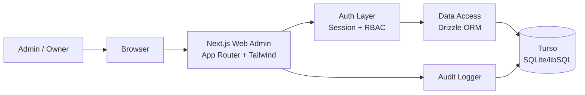
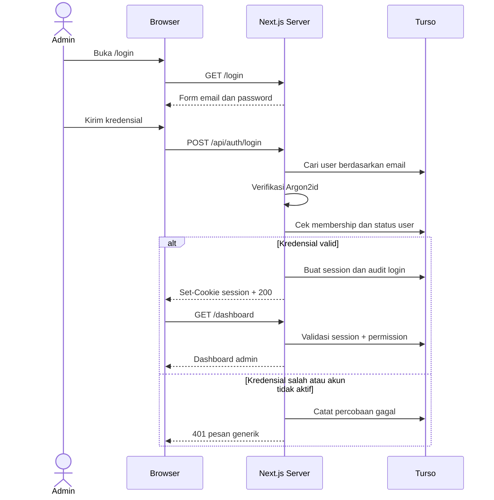
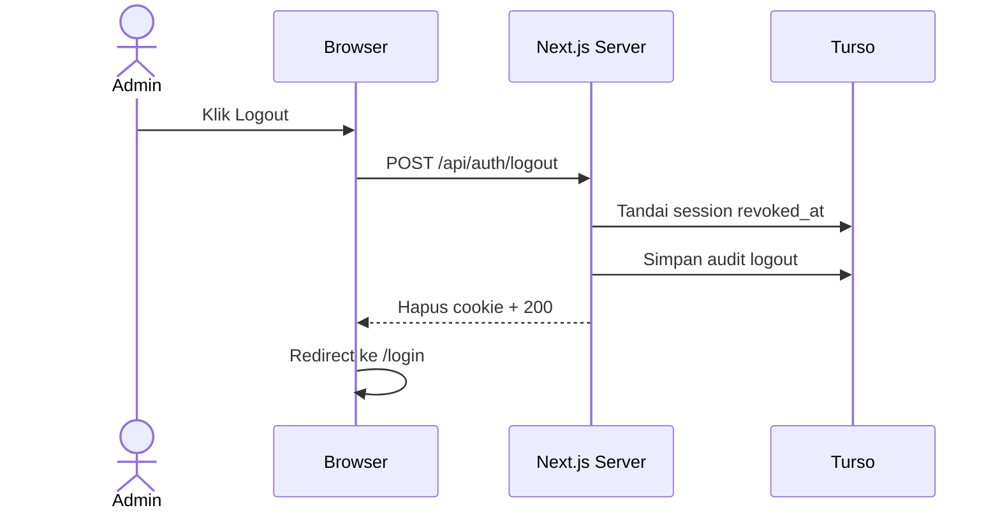
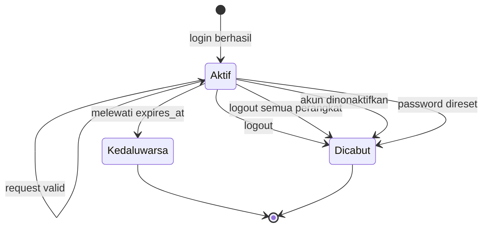
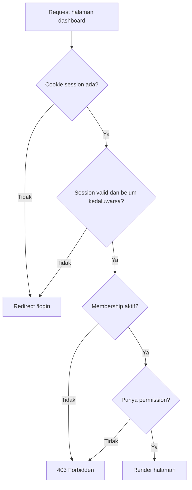
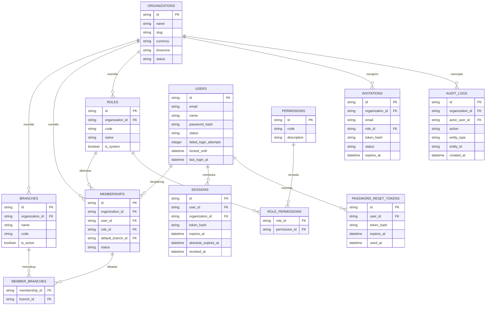

# Issue: Web Admin — Login, Dashboard, Manajemen User, dan Logout

> Dokumen ini merupakan turunan dan spesifikasi implementasi dari master plan pada GitHub issue [#1](https://github.com/anwar1193/pos-application/issues/1). Fokus dokumen ini hanya pada empat fitur pertama Web Admin dengan database **Turso**.

## 1. Ringkasan

Membangun fondasi **Web Admin** untuk aplikasi POS dengan ruang lingkup:

1. **Login Web Admin** — autentikasi email dan password, pembuatan session, pembatasan percobaan login, dan audit.
2. **Dashboard Admin** — ringkasan organisasi, statistik pengguna, sesi aktif, dan aktivitas terbaru.
3. **Manajemen User Pengguna** — daftar, undang, ubah role/cabang, nonaktifkan, aktifkan kembali, dan reset password.
4. **Logout Web Admin** — mencabut session aktif, menghapus cookie, dan logout dari semua perangkat.

Database menggunakan **Turso** dengan akses melalui libSQL client dan Drizzle ORM.

### 1.1 Posisi dalam Roadmap

Fitur ini adalah **Phase 0–1** dari master plan:

- Fondasi project dan database.
- Identity & Access.
- Organization, branch, membership, role, dan permission.
- Layout dashboard admin.
- Manajemen user.

Fitur penjualan, produk, stok, dan laporan **belum termasuk** dalam dokumen ini. Dashboard tidak boleh menampilkan data penjualan palsu atau placeholder yang terlihat seperti data nyata.

## 2. Tujuan

1. Admin dapat masuk ke Web Admin dengan aman.
2. Session dapat divalidasi di server pada setiap request halaman dan API.
3. Admin dapat melihat kondisi dasar organisasi dan pengguna.
4. Owner/Admin dapat mengelola user sesuai role dan scope organisasi/cabang.
5. Logout mencabut session di server, bukan hanya menghapus cookie di browser.
6. Semua aksi sensitif tercatat pada audit log.
7. Fondasi autentikasi dapat dipakai ulang oleh modul berikutnya dan mobile app.

## 3. Ruang Lingkup

### 3.1 In Scope

- Login email + password.
- Session berbasis cookie HttpOnly.
- Proteksi route dashboard.
- Dashboard admin versi awal.
- Daftar dan detail user.
- Undangan user baru.
- Perubahan role dan cabang.
- Nonaktifkan dan aktifkan kembali user.
- Reset password oleh Admin/Owner melalui one-time link.
- Ganti password untuk user yang sedang login.
- Logout perangkat ini dan logout semua perangkat.
- Audit log untuk login, logout, dan perubahan user.
- Rate limiting dan account lockout.
- Migration, seed, dan testing.

### 3.2 Out of Scope

- Registrasi publik atau self-signup organisasi.
- Login dengan Google, SSO, atau 2FA.
- Pengiriman email transaksional otomatis.
- Modul penjualan, produk, stok, dan laporan pada dashboard.
- Aplikasi mobile dan autentikasi mobile.
- Multi-organisasi dengan organization switcher lanjutan.
- Manajemen permission custom oleh pengguna.
- UI audit log lengkap; pada tahap ini audit hanya ditampilkan sebagai aktivitas terbaru di dashboard.
- Penghapusan user secara permanen.

## 4. Asumsi dan Keputusan Awal

1. **Belum ada registrasi publik.** Owner pertama dibuat melalui seed script yang idempoten. Ini mencegah siapa pun membuat organisasi tanpa kontrol.
2. **Satu user memiliki satu membership aktif per organisasi.** Struktur tabel mendukung multi-organisasi, tetapi UI tahap ini memakai organisasi default dari membership.
3. **Undangan dibagikan manual.** Sistem membuat link undangan satu kali pakai; pengiriman email otomatis ditunda.
4. **Dashboard tanpa metrik penjualan.** Widget penjualan baru ditambahkan setelah modul Sales tersedia.
5. **Web memakai session cookie.** Mobile nantinya memakai token terpisah; tabel `sessions` dibuat cukup umum untuk mendukung keduanya.
6. **Turso remote sebagai database utama.** Embedded replica dan offline mode tidak dipakai pada tahap ini.
7. **Node.js runtime.** Route yang memakai hashing password dan libSQL berjalan pada Node.js runtime, bukan Edge.
8. **Role sistem bersifat tetap.** Owner, Admin, Manager, Kasir, dan Staff Gudang disediakan sebagai system role; permission tidak diedit dari UI.
9. **Data user bersifat global, akses bersifat per organisasi.** Identitas disimpan di `users`, sedangkan role dan status keanggotaan disimpan di `memberships`.
10. **User tidak dihapus permanen.** Penonaktifan memakai status dan pencabutan session.

## 5. Tech Stack

| Bagian | Teknologi |
|---|---|
| Framework web | Next.js App Router |
| Bahasa | TypeScript |
| Styling | Tailwind CSS |
| Form | React Hook Form + Zod |
| Database | Turso |
| Driver | `@libsql/client` |
| ORM | Drizzle ORM + Drizzle Kit |
| Password hashing | Argon2id |
| Testing | Vitest + Playwright |
| Runtime | Node.js |

### 5.1 Environment Variables

```env
TURSO_DATABASE_URL=libsql://...
TURSO_AUTH_TOKEN=...
APP_URL=http://localhost:3000
SEED_OWNER_EMAIL=owner@example.com
SEED_OWNER_PASSWORD=change-me-in-development
SEED_ORGANIZATION_NAME=Demo Store
SEED_BRANCH_NAME=Main Branch
```

Aturan:

- `SEED_OWNER_PASSWORD` hanya dipakai di environment lokal/development.
- Secret tidak boleh masuk repository.
- `TURSO_AUTH_TOKEN` harus memiliki izin minimum yang dibutuhkan aplikasi.

## 6. Arsitektur

### 6.1 Diagram Arsitektur



### 6.2 Pembagian Modul Internal

```text
src/
├── app/
│   ├── (auth)/login/page.tsx
│   ├── (dashboard)/layout.tsx
│   ├── (dashboard)/dashboard/page.tsx
│   ├── (dashboard)/users/page.tsx
│   ├── (dashboard)/users/[id]/page.tsx
│   ├── invite/[token]/page.tsx
│   ├── reset-password/[token]/page.tsx
│   └── api/
│       ├── auth/login/route.ts
│       ├── auth/logout/route.ts
│       ├── auth/logout-all/route.ts
│       ├── auth/session/route.ts
│       ├── auth/password/route.ts
│       ├── dashboard/summary/route.ts
│       ├── users/route.ts
│       ├── users/[id]/route.ts
│       ├── users/[id]/deactivate/route.ts
│       ├── users/[id]/reactivate/route.ts
│       ├── users/[id]/password-reset/route.ts
│       └── invitations/[id]/route.ts
├── db/
│   ├── schema/
│   ├── migrations/
│   └── seed.ts
└── lib/
    ├── auth/
    │   ├── password.ts
    │   ├── session.ts
    │   ├── permissions.ts
    │   └── guard.ts
    ├── db/
    │   ├── client.ts
    │   └── repositories/
    ├── validation/
    └── audit/
```

Aturan penting:

- Halaman tidak mengakses database langsung dari komponen client.
- Semua mutasi melewati route handler atau server action yang memanggil service.
- Pengecekan permission dilakukan di server, bukan hanya dengan menyembunyikan menu.
- Semua query data user wajib menyertakan `organization_id` dari session.

### 6.3 Route Web

| Route | Akses | Fungsi |
|---|---|---|
| `/login` | Publik | Form login |
| `/invite/[token]` | Publik dengan token valid | Aktivasi akun undangan |
| `/reset-password/[token]` | Publik dengan token valid | Set password baru |
| `/dashboard` | Session + `dashboard.view` | Dashboard admin |
| `/users` | Session + `user.view` | Daftar user |
| `/users/[id]` | Session + `user.view` | Detail user |

Redirect:

- Belum login → `/login?next=<path>`.
- Sudah login membuka `/login` → `/dashboard`.
- Tidak punya permission → halaman 403.
- Session kedaluwarsa saat request API → `401 AUTH_SESSION_EXPIRED`.

## 7. Alur Autentikasi

### 7.1 Alur Login



Detail yang wajib:

1. Normalisasi email: trim dan lowercase.
2. Cari user berdasarkan email.
3. Jika user tidak ditemukan, tetap jalankan verifikasi terhadap dummy hash agar waktu respons tidak membocorkan keberadaan akun.
4. Verifikasi password dengan Argon2id.
5. Tolak jika user berstatus `suspended` atau `disabled`.
6. Tolak jika membership tidak aktif pada organisasi.
7. Buat session baru; token lama tidak dipakai ulang.
8. Simpan hash token, bukan token asli.
9. Set cookie session.
10. Catat audit `auth.login.success`.
11. Redirect ke `next` hanya jika path internal dan aman; selain itu ke `/dashboard`.

### 7.2 Alur Logout



Aturan logout:

- Hanya menerima `POST`.
- Memvalidasi Origin/Referer untuk mencegah CSRF.
- Mencabut session saat ini di database.
- Menghapus cookie dengan atribut yang sama saat dibuat.
- Logout semua perangkat mencabut seluruh session aktif milik user.
- Endpoint tetap mengembalikan sukses walau session sudah tidak valid, agar tidak terjadi loop error.
- User yang dinonaktifkan harus langsung kehilangan akses pada request berikutnya.

### 7.3 Siklus Hidup Session



Ketentuan session:

- Token: 32 byte acak, di-encode base64url.
- Yang disimpan di database hanya SHA-256 dari token.
- Cookie: `HttpOnly`, `Secure` di production, `SameSite=Lax`, `Path=/`.
- Idle timeout: 7 hari.
- Absolute timeout: 30 hari.
- `last_seen_at` diperbarui maksimal sekali per 5 menit untuk mengurangi write.
- Session dicabut jika user dinonaktifkan atau password direset.
- Session tidak boleh menyimpan data sensitif di cookie; cookie hanya berisi token acak.

### 7.4 Proteksi Route



Implementasi:

- Helper `getSession()` membaca cookie, memvalidasi hash token, dan memuat user + membership + role + permission.
- Helper `requirePermission(permission)` melempar `401` atau `403` yang konsisten.
- Middleware hanya melakukan redirect ringan berdasarkan keberadaan cookie; validasi session tetap dilakukan di server component/route handler.
- Jangan pernah mempercayai `organization_id` atau `role` yang dikirim client.

### 7.5 Session Sliding dan Rotasi

- Cookie diperbarui ketika sisa umur kurang dari setengah idle timeout.
- Rotasi token dilakukan saat login dan saat perubahan hak akses penting.
- Rotasi menghapus session lama dan membuat session baru.
- Session yang dicabut tidak boleh diaktifkan kembali.

## 8. Model Akses dan Permission

### 8.1 Permission yang Dipakai

| Permission | Deskripsi |
|---|---|
| `dashboard.view` | Melihat dashboard |
| `user.view` | Melihat daftar dan detail user |
| `user.invite` | Mengundang user baru |
| `user.update` | Mengubah data, role, dan cabang user |
| `user.deactivate` | Menonaktifkan atau mengaktifkan user |
| `user.reset_password` | Membuat link reset password |
| `role.assign` | Memberikan role kepada user |
| `session.revoke` | Mencabut session user lain |
| `audit.view` | Melihat aktivitas audit di dashboard |

### 8.2 Matriks Role

| Aksi | Owner | Admin | Manager | Kasir | Staff Gudang |
|---|---|---|---|---|---|
| Login Web Admin | Ya | Ya | Ya | Tidak | Tidak |
| Lihat dashboard | Ya | Ya | Ya | — | — |
| Lihat user | Ya | Ya | Ya, cabang sendiri | — | — |
| Undang user | Ya | Ya | Tidak | — | — |
| Ubah user | Ya | Ya | Tidak | — | — |
| Nonaktifkan user | Ya | Ya | Tidak | — | — |
| Reset password user | Ya | Ya | Tidak | — | — |
| Assign role Owner | Ya | Tidak | Tidak | — | — |
| Assign role Admin | Ya | Tidak | Tidak | — | — |
| Cabut session user | Ya | Ya | Tidak | — | — |

Catatan:

- Manager hanya read-only dan dibatasi pada cabang yang ditugaskan.
- Admin tidak boleh mengubah, menonaktifkan, atau mereset password Owner.
- Hanya Owner yang boleh memberikan role Owner atau Admin.
- Role Kasir dan Staff Gudang belum memakai Web Admin pada tahap ini.

### 8.3 Pengamanan Tambahan

- User tidak dapat menonaktifkan dirinya sendiri.
- User tidak dapat menurunkan role dirinya sendiri.
- Owner terakhir yang aktif tidak dapat dinonaktifkan atau diturunkan.
- Admin tidak dapat mengubah user dari organisasi lain.
- Semua perubahan role dan status dicatat pada audit log.
- Jumlah Owner aktif minimal satu; validasi dilakukan dalam database transaction.

## 9. Rancangan Database Turso

### 9.1 Konfigurasi Turso

```bash
turso db create pos-application
turso db show pos-application --url
turso db tokens create pos-application
```

Drizzle:

```ts
// drizzle.config.ts
import { defineConfig } from "drizzle-kit";

export default defineConfig({
  dialect: "turso",
  schema: "./src/db/schema",
  out: "./src/db/migrations",
  dbCredentials: {
    url: process.env.TURSO_DATABASE_URL!,
    authToken: process.env.TURSO_AUTH_TOKEN,
  },
});
```

Ketentuan:

- Gunakan satu client libSQL per proses/server instance.
- Jangan membuat koneksi baru pada setiap query.
- Operasi multi-tabel wajib memakai transaction atau batch atomik.
- Migration dijalankan melalui pipeline/CLI, bukan otomatis saat request.
- Foreign key harus diaktifkan dan diuji.
- Semua timestamp disimpan dalam UTC.

### 9.2 Diagram Relasi Data



### 9.3 Detail Tabel

#### `organizations`

- `id` TEXT PK
- `name` TEXT NOT NULL
- `slug` TEXT NOT NULL UNIQUE
- `currency` TEXT NOT NULL DEFAULT `'IDR'`
- `timezone` TEXT NOT NULL DEFAULT `'Asia/Jakarta'`
- `status` TEXT NOT NULL DEFAULT `'active'` — `active`, `suspended`
- `created_at`, `updated_at`

#### `branches`

- `id` TEXT PK
- `organization_id` TEXT NOT NULL FK
- `name` TEXT NOT NULL
- `code` TEXT NOT NULL
- `phone` TEXT NULL
- `address` TEXT NULL
- `is_active` INTEGER NOT NULL DEFAULT 1
- `created_at`, `updated_at`
- Unique `(organization_id, code)`

#### `users`

- `id` TEXT PK
- `email` TEXT NOT NULL UNIQUE — disimpan lowercase
- `name` TEXT NOT NULL
- `phone` TEXT NULL
- `password_hash` TEXT NULL — null sebelum undangan diterima
- `status` TEXT NOT NULL — `invited`, `active`, `suspended`, `disabled`
- `email_verified_at` DATETIME NULL
- `last_login_at` DATETIME NULL
- `failed_login_attempts` INTEGER NOT NULL DEFAULT 0
- `locked_until` DATETIME NULL
- `created_at`, `updated_at`

#### `memberships`

- `id` TEXT PK
- `organization_id` TEXT NOT NULL FK
- `user_id` TEXT NOT NULL FK
- `role_id` TEXT NOT NULL FK
- `default_branch_id` TEXT NULL FK
- `status` TEXT NOT NULL — `invited`, `active`, `suspended`
- `created_at`, `updated_at`
- Unique `(organization_id, user_id)`
- Index `(organization_id, status)`

#### `roles`

- `id` TEXT PK
- `organization_id` TEXT NULL FK — null untuk system role
- `code` TEXT NOT NULL — `owner`, `admin`, `manager`, `cashier`, `warehouse`
- `name` TEXT NOT NULL
- `is_system` INTEGER NOT NULL DEFAULT 0
- `created_at`
- Unique `(organization_id, code)`

#### `permissions`

- `id` TEXT PK
- `code` TEXT NOT NULL UNIQUE
- `description` TEXT NULL

#### `role_permissions`

- `role_id` TEXT NOT NULL FK
- `permission_id` TEXT NOT NULL FK
- Primary key gabungan

#### `member_branches`

- `membership_id` TEXT NOT NULL FK
- `branch_id` TEXT NOT NULL FK
- Primary key gabungan

Dipakai untuk membatasi Manager pada cabang tertentu. Owner dan Admin dapat memiliki akses seluruh cabang.

#### `sessions`

- `id` TEXT PK
- `user_id` TEXT NOT NULL FK
- `organization_id` TEXT NOT NULL FK
- `token_hash` TEXT NOT NULL UNIQUE
- `user_agent` TEXT NULL
- `ip_hash` TEXT NULL
- `created_at`, `last_seen_at`
- `expires_at` DATETIME NOT NULL
- `absolute_expires_at` DATETIME NOT NULL
- `revoked_at` DATETIME NULL
- `revoked_reason` TEXT NULL
- Index `(user_id, revoked_at)`, `(expires_at)`

#### `invitations`

- `id` TEXT PK
- `organization_id` TEXT NOT NULL FK
- `email` TEXT NOT NULL
- `name` TEXT NOT NULL
- `role_id` TEXT NOT NULL FK
- `branch_id` TEXT NULL FK
- `token_hash` TEXT NOT NULL UNIQUE
- `invited_by` TEXT NOT NULL FK ke `users`
- `status` TEXT NOT NULL — `pending`, `accepted`, `revoked`, `expired`
- `expires_at` DATETIME NOT NULL
- `accepted_at` DATETIME NULL
- `created_at`
- Index `(organization_id, status)`
- Cegah undangan `pending` ganda untuk email yang sama dalam organisasi.

#### `password_reset_tokens`

- `id` TEXT PK
- `user_id` TEXT NOT NULL FK
- `token_hash` TEXT NOT NULL UNIQUE
- `created_by` TEXT NULL FK ke `users`
- `expires_at` DATETIME NOT NULL
- `used_at` DATETIME NULL
- `created_at`

#### `audit_logs`

- `id` TEXT PK
- `organization_id` TEXT NOT NULL FK
- `branch_id` TEXT NULL FK
- `actor_user_id` TEXT NULL FK
- `action` TEXT NOT NULL
- `entity_type` TEXT NOT NULL
- `entity_id` TEXT NULL
- `before_data` TEXT NULL — JSON
- `after_data` TEXT NULL — JSON
- `metadata` TEXT NULL — JSON
- `ip_hash` TEXT NULL
- `user_agent` TEXT NULL
- `created_at` DATETIME NOT NULL
- Index `(organization_id, created_at)`, `(entity_type, entity_id)`

#### `login_attempts`

- `id` TEXT PK
- `email_hash` TEXT NOT NULL
- `ip_hash` TEXT NOT NULL
- `success` INTEGER NOT NULL
- `created_at` DATETIME NOT NULL
- Index `(email_hash, created_at)`, `(ip_hash, created_at)`

Dipakai untuk rate limiting berbasis database. Jika volume tinggi, rate limit dapat dipindahkan ke penyimpanan khusus, tetapi implementasi awal tetap harus konsisten dan dapat diuji.

### 9.4 Index dan Constraint Penting

- Email user unik secara global.
- `(organization_id, code)` unik pada branch dan role.
- `(organization_id, user_id)` unik pada membership.
- Index pada kolom yang sering difilter: `users.status`, `memberships.organization_id`, `memberships.role_id`, `sessions.user_id`, `sessions.expires_at`, `audit_logs.created_at`.
- Foreign key tidak memakai cascade delete pada data audit dan session.
- Check constraint untuk `status` agar nilai tidak sembarang.
- Nominal dan tanggal memakai tipe yang konsisten; waktu disimpan UTC.

### 9.5 Migration dan Seed

- Schema dikelola dengan Drizzle Kit.
- Migration harus dapat dijalankan dari database kosong tanpa intervensi manual.
- Seed bersifat idempoten: membuat organisasi, cabang utama, system roles, permissions, dan owner jika belum ada.
- Password owner diambil dari environment variable, bukan hardcode.
- Seed tidak boleh dijalankan otomatis di production tanpa persetujuan.

## 10. Login Web Admin

### 10.1 Halaman Login

Elemen:

- Logo dan nama aplikasi.
- Field email.
- Field password dengan tombol tampilkan/sembunyikan.
- Tombol **Masuk**.
- Pesan error generik.
- Status loading pada tombol.
- Link bantuan "Hubungi administrator" jika lupa password.
- Fokus otomatis pada field email.
- Enter mengirim form.

Aturan:

- Jangan menampilkan apakah email terdaftar.
- Jangan mengisi ulang field password setelah gagal.
- Disable tombol saat request berjalan.
- Setelah login sukses, redirect ke `next` yang tervalidasi atau `/dashboard`.

### 10.2 Validasi

- Email wajib dan berformat valid.
- Password wajib.
- Panjang input dibatasi untuk mencegah payload berlebihan.
- Validasi client hanya untuk UX; validasi server tetap wajib.

### 10.3 Pesan Error

| Kondisi | Pesan pengguna |
|---|---|
| Email/password salah | Email atau password salah. |
| Akun terkunci | Terlalu banyak percobaan. Coba lagi beberapa saat lagi. |
| Akun nonaktif | Akun Anda tidak aktif. Hubungi administrator. |
| Rate limit | Terlalu banyak percobaan. Coba lagi nanti. |
| Server error | Terjadi kesalahan. Silakan coba lagi. |

Pesan tidak boleh menyebut field mana yang salah atau apakah akun ada.

### 10.4 Rate Limiting dan Lockout

- Maksimal 5 kegagalan per kombinasi email + IP dalam 15 menit.
- Maksimal 20 kegagalan per IP dalam 15 menit.
- Setelah 10 kegagalan berturut-turut pada akun, kunci akun selama 15 menit.
- Login sukses mereset `failed_login_attempts`.
- Percobaan gagal dicatat tanpa menyimpan password.
- Saat akun terkunci, verifikasi password tetap tidak boleh membocorkan status akun selain pesan lockout.

### 10.5 Password Policy

- Minimal 12 karakter, maksimal 128 karakter.
- Tidak memotong password secara diam-diam.
- Tidak mewajibkan kombinasi karakter yang rumit; utamakan panjang.
- Tolak password yang sama dengan email atau nama user.
- Argon2id dengan konfigurasi memori dan iterasi yang wajar; parameter disimpan agar dapat di-upgrade.
- Rehash otomatis saat login jika parameter hash sudah usang.

### 10.6 Anti Session Fixation

- Session baru dibuat saat login.
- Session lama milik browser yang sama tidak dipertahankan.
- Token session tidak boleh berasal dari input client.
- Rotasi token setelah perubahan password.

## 11. Logout Web Admin

### 11.1 Logout Perangkat Ini

- Endpoint: `POST /api/auth/logout`.
- Mencabut session aktif.
- Menghapus cookie.
- Audit `auth.logout`.
- Redirect ke `/login`.

### 11.2 Logout Semua Perangkat

- Endpoint: `POST /api/auth/logout-all`.
- Mencabut seluruh session aktif user.
- Audit `auth.logout_all`.
- Menghapus cookie perangkat saat ini.
- Redirect ke `/login`.

### 11.3 Session yang Sudah Dicabut

- Request API mengembalikan `401 AUTH_SESSION_EXPIRED`.
- Request halaman diarahkan ke `/login`.
- Tidak boleh terjadi redirect loop.
- Cookie yang tidak valid dibersihkan.

## 12. Dashboard Admin

### 12.1 Tujuan

Memberi Owner/Admin/Manager gambaran cepat tentang organisasi dan pengguna tanpa menampilkan data yang belum tersedia.

### 12.2 Layout

- Sidebar: Dashboard, Users, Settings (disabled sampai modul tersedia).
- Topbar: nama organisasi, pemilih cabang, nama user, menu profil.
- Menu profil: Ganti password, Logout, Logout semua perangkat.
- Konten: kartu ringkasan, tabel aktivitas, dan quick actions.

### 12.3 Widget Versi Ini

| Widget | Data |
|---|---|
| Total user aktif | Jumlah membership `active` dalam organisasi |
| User per role | Agregasi membership berdasarkan role |
| Undangan pending | Jumlah invitation `pending` yang belum kedaluwarsa |
| Session aktif 24 jam | Jumlah user unik dengan session aktif dalam 24 jam terakhir |
| Jumlah cabang | Jumlah branch aktif |
| Login terbaru | 10 audit login terakhir |
| Aktivitas terbaru | 10 audit log terakhir |
| Quick actions | Undang user, lihat daftar user |

Widget yang **tidak** ditampilkan pada tahap ini:

- Penjualan hari ini.
- Produk terlaris.
- Stok rendah.
- Grafik pendapatan.
- Metode pembayaran.

Jangan mengisi widget tersebut dengan angka nol palsu atau data contoh.

### 12.4 Scope Data

- Owner dan Admin melihat seluruh organisasi.
- Manager melihat data user pada cabang yang ditugaskan.
- Branch selector hanya memengaruhi widget yang memang memiliki dimensi cabang.
- Semua agregasi dilakukan server-side dengan `organization_id` dari session.

### 12.5 API Dashboard

`GET /api/dashboard/summary`

Response:

```json
{
  "data": {
    "organization": {
      "id": "org_...",
      "name": "Demo Store"
    },
    "branchCount": 2,
    "userCounts": {
      "active": 8,
      "invited": 1,
      "suspended": 0
    },
    "usersByRole": [
      { "role": "owner", "count": 1 },
      { "role": "admin", "count": 2 },
      { "role": "manager", "count": 1 },
      { "role": "cashier", "count": 4 }
    ],
    "pendingInvitations": 1,
    "activeSessions24h": 3,
    "recentLogins": [],
    "recentActivity": []
  },
  "meta": {
    "requestId": "..."
  }
}
```

Ketentuan:

- Cache maksimal 30 detik atau gunakan `no-store` jika akurasi lebih penting.
- Jangan mengembalikan hash, token, atau data sensitif.
- Jika tidak punya `dashboard.view`, kembalikan `403`.

### 12.6 State UI

- Loading: skeleton pada kartu dan tabel.
- Empty: pesan "Belum ada aktivitas" dan ajakan mengundang user.
- Error: pesan ringkas dan tombol coba lagi.
- Partial error: satu widget gagal tidak boleh membuat seluruh halaman kosong.

## 13. Manajemen User Pengguna

### 13.1 Daftar User

Kolom:

- Nama.
- Email.
- Role.
- Cabang.
- Status.
- Login terakhir.
- Aksi.

Fitur:

- Pencarian berdasarkan nama atau email, debounce 300 ms.
- Filter role.
- Filter status.
- Filter cabang untuk Owner/Admin.
- Sorting nama, role, status, dan login terakhir.
- Pagination server-side, default 20 per halaman.
- Empty state.
- Loading skeleton.
- Tombol **Undang User** hanya muncul jika punya `user.invite`.

### 13.2 Detail User

Menampilkan:

- Nama, email, telepon.
- Role dan cabang.
- Status membership.
- Tanggal bergabung.
- Login terakhir.
- Session aktif.
- Riwayat aktivitas terakhir milik user tersebut.

Aksi:

- Ubah nama dan telepon.
- Ubah role.
- Ubah cabang.
- Reset password.
- Nonaktifkan atau aktifkan kembali.
- Cabut semua session.

### 13.3 Undangan User

Alur:

1. Admin membuka form undangan.
2. Admin mengisi nama, email, role, dan cabang.
3. Server memvalidasi permission dan batas role.
4. Server menolak jika email sudah menjadi member aktif.
5. Server membuat `users` berstatus `invited` jika belum ada, atau memakai user yang sudah ada tanpa membership.
6. Server membuat `memberships` berstatus `invited`.
7. Server membuat `invitations` dengan token acak satu kali pakai.
8. Server menyimpan hash token, bukan token asli.
9. Admin menerima link undangan untuk dibagikan secara aman.
10. Audit `user.invited` dicatat.

Aturan:

- Token undangan berlaku 7 hari.
- Token hanya dapat dipakai sekali.
- Link undangan menampilkan nama organisasi dan email yang diundang.
- Penerima menetapkan password baru.
- Setelah aktivasi, user berstatus `active`, membership `active`, dan invitation `accepted`.
- Undangan dapat dicabut sebelum diterima.
- Email provider belum terintegrasi; link ditampilkan sekali dan dapat dibuat ulang.

Catatan keamanan:

- Jangan menampilkan password sementara.
- Jangan mengirim password melalui UI.
- Link undangan diperlakukan sebagai secret.
- Token disimpan sebagai hash dan tidak dicatat pada log.

### 13.4 Perubahan Role

- Hanya Owner yang dapat memberikan role Owner atau Admin.
- Admin tidak dapat mengubah Owner.
- Tidak dapat menurunkan Owner terakhir.
- Tidak dapat menurunkan role diri sendiri.
- Perubahan role mencabut session user yang terdampak agar permission baru langsung berlaku.
- Audit menyimpan role sebelum dan sesudah.

### 13.5 Nonaktifkan dan Aktifkan Kembali

- Nonaktifkan mengubah membership menjadi `suspended` dan user menjadi `suspended` jika tidak punya membership aktif lain.
- Semua session user dicabut.
- Data transaksi dan audit tidak dihapus.
- Tidak dapat menonaktifkan diri sendiri.
- Tidak dapat menonaktifkan Owner terakhir.
- Aktivasi kembali mengubah status menjadi `active` dan mencatat audit.
- User yang diaktifkan kembali harus login ulang.

### 13.6 Reset Password oleh Admin

- Admin membuat one-time link reset untuk user.
- Token berlaku 30 menit.
- Token disimpan sebagai hash.
- Link ditampilkan kepada Admin untuk dibagikan secara aman.
- Setelah password baru ditetapkan, seluruh session user dicabut.
- Audit `user.password_reset_requested` dan `user.password_changed`.
- Reset tidak boleh membocorkan apakah email terdaftar; aksi ini hanya tersedia untuk user yang memang terlihat oleh Admin.

### 13.7 Ganti Password Sendiri

- Endpoint: `PATCH /api/auth/password`.
- Wajib memasukkan password lama.
- Password baru mengikuti policy.
- Semua session lain dicabut; session saat ini dirotasi.
- Audit `user.password_changed`.

### 13.8 Pengamanan Data

- Semua query user dibatasi `organization_id`.
- Response tidak menyertakan `password_hash`, `token_hash`, atau data internal session.
- User dari organisasi lain menghasilkan `404` atau `403` yang konsisten tanpa membocorkan keberadaan data.
- Aksi admin terhadap dirinya sendiri mengikuti aturan yang sama seperti user lain, kecuali larangan self-deactivation dan self-demotion.

### 13.9 API Manajemen User

| Method | Endpoint | Permission |
|---|---|---|
| GET | `/api/users` | `user.view` |
| GET | `/api/users/:id` | `user.view` |
| POST | `/api/users/invitations` | `user.invite` |
| PATCH | `/api/users/:id` | `user.update` |
| POST | `/api/users/:id/deactivate` | `user.deactivate` |
| POST | `/api/users/:id/reactivate` | `user.deactivate` |
| POST | `/api/users/:id/password-reset` | `user.reset_password` |
| POST | `/api/users/:id/sessions/revoke` | `session.revoke` |
| DELETE | `/api/invitations/:id` | `user.invite` |
| GET | `/api/roles` | `user.view` |
| GET | `/api/branches` | `user.view` |

Ketentuan API:

- Pagination dan filter divalidasi dengan Zod.
- Response memakai format `data` dan `meta` yang konsisten dengan master plan.
- Semua mutasi memeriksa Origin/Referer.
- Mutasi idempoten bila memungkinkan, atau minimal aman terhadap double submit.
- Perubahan role dan status memakai database transaction.

### 13.10 Error Code

| Code | HTTP | Arti |
|---|---|---|
| `AUTH_REQUIRED` | 401 | Belum login |
| `AUTH_INVALID_CREDENTIALS` | 401 | Email/password salah |
| `AUTH_SESSION_EXPIRED` | 401 | Session tidak valid |
| `AUTH_ACCOUNT_LOCKED` | 423 | Akun terkunci |
| `AUTH_ACCOUNT_INACTIVE` | 403 | Akun nonaktif |
| `FORBIDDEN` | 403 | Tidak punya permission |
| `RATE_LIMITED` | 429 | Terlalu banyak percobaan |
| `VALIDATION_ERROR` | 422 | Input tidak valid |
| `USER_EMAIL_EXISTS` | 409 | Email sudah terdaftar |
| `INVITATION_EXPIRED` | 410 | Undangan kedaluwarsa |
| `LAST_OWNER_PROTECTED` | 409 | Owner terakhir dilindungi |
| `SELF_DEACTIVATION_FORBIDDEN` | 409 | Tidak dapat menonaktifkan diri sendiri |
| `NOT_FOUND` | 404 | Data tidak ditemukan |
| `CONFLICT` | 409 | Konflik state |

Format error mengikuti master plan:

```json
{
  "error": {
    "code": "FORBIDDEN",
    "message": "Anda tidak memiliki akses.",
    "fields": {},
    "requestId": "..."
  }
}
```

## 14. Audit Log

### 14.1 Aksi yang Dicatat

- `auth.login.success`
- `auth.login.failed`
- `auth.logout`
- `auth.logout_all`
- `session.revoked`
- `user.invited`
- `user.updated`
- `user.role_changed`
- `user.deactivated`
- `user.reactivated`
- `user.password_reset_requested`
- `user.password_changed`
- `invitation.revoked`

### 14.2 Data Audit

- `organization_id`
- `actor_user_id`
- `action`
- `entity_type`
- `entity_id`
- `before_data` dan `after_data` untuk perubahan user/role
- `metadata` untuk konteks tambahan
- `ip_hash` dan `user_agent`
- `created_at`

Aturan:

- Jangan menyimpan password, token, cookie, atau authorization header.
- Gagal menulis audit pada aksi sensitif harus membuat aksi tersebut gagal, kecuali untuk login gagal yang tetap dicatat sebisanya.
- Audit log tidak dapat diubah atau dihapus dari UI.

## 15. UI/UX dan Aksesibilitas

- Layout responsif untuk desktop, tablet, dan mobile web.
- Form memiliki label eksplisit dan pesan error di dekat field.
- Fokus keyboard terlihat jelas.
- Tombol aksi destruktif memakai konfirmasi yang menjelaskan konsekuensi.
- Status tidak hanya dibedakan dengan warna; gunakan teks.
- Loading state tidak menggeser layout secara mendadak.
- Toast sukses dan error dapat ditutup.
- Nama organisasi dan cabang selalu terlihat agar admin tahu konteks data.
- Nominal tidak ditampilkan pada tahap ini karena belum ada data transaksi.
- Waktu ditampilkan sesuai timezone organisasi.
- Tidak ada data mock yang terlihat seperti data produksi.

## 16. Testing

### 16.1 Unit Test

- Validasi password policy.
- Hash dan verifikasi Argon2id.
- Pembuatan dan hashing session token.
- Perhitungan waktu kedaluwarsa session.
- Matriks permission per role.
- Aturan Owner terakhir.
- Aturan self-deactivation dan self-demotion.
- Normalisasi email.
- Validasi input undangan.

### 16.2 Integration Test

- Login sukses membuat session dan audit.
- Login gagal mencatat percobaan dan tidak membuat session.
- Rate limit dan lockout.
- Session kedaluwarsa ditolak.
- Logout mencabut session.
- Logout semua perangkat mencabut seluruh session.
- User nonaktif tidak dapat login dan session lama tidak valid.
- Undangan: buat, terima, kedaluwarsa, cabut.
- Reset password mencabut session lama.
- Perubahan role mencabut session terdampak.
- Isolasi data antar organisasi.
- Admin tidak dapat mengubah Owner.
- Owner terakhir tidak dapat dinonaktifkan.
- Query user tidak mengembalikan hash.

### 16.3 End-to-End Test

1. Seed owner.
2. Owner login.
3. Owner melihat dashboard.
4. Owner mengundang Admin.
5. Admin membuka link undangan dan menetapkan password.
6. Admin login.
7. Admin mengundang Kasir.
8. Admin menonaktifkan Kasir.
9. Kasir tidak dapat login.
10. Admin mengaktifkan kembali Kasir.
11. Owner logout.
12. Session tidak dapat dipakai lagi.

### 16.4 Security Test

- CSRF pada logout dan mutasi user.
- Session fixation.
- Cookie flags.
- IDOR antar organisasi.
- Permission escalation.
- Enumeration email pada login.
- Brute force dan lockout.
- XSS pada nama user dan nama organisasi.
- Open redirect pada parameter `next`.
- Token undangan dan reset password tidak muncul di log.

## 17. Observability

- Setiap request memiliki `requestId`.
- Log terstruktur untuk login sukses/gagal, logout, dan mutasi user.
- Jangan mencatat password, token, atau cookie.
- Metrik minimum: login success rate, login failure count, lockout count, session active count, error rate API auth.
- Health check sederhana untuk koneksi Turso.
- Alert untuk lonjakan login gagal dan error 5xx.

## 18. Tahapan Implementasi

### Phase 0 — Fondasi

- Inisialisasi Next.js, TypeScript, Tailwind, lint, dan test.
- Setup Drizzle, libSQL client, dan koneksi Turso.
- Setup environment variables.
- Setup layout dasar dan komponen UI reusable.

### Phase 1 — Schema dan Seed

- Tabel organisasi, branch, user, membership, role, permission.
- Tabel session, invitation, password reset, audit, login attempt.
- Migration awal.
- Seed system roles, permissions, organisasi demo, branch, dan owner.
- Integration test koneksi dan constraint.

### Phase 2 — Auth Core

- Password hashing.
- Session creation, validation, rotation, revocation.
- Permission resolver.
- Rate limit dan lockout.
- Audit logger.

### Phase 3 — Login

- Halaman login.
- Endpoint login.
- Redirect aman.
- State loading dan error.
- Test login sukses/gagal/lockout.

### Phase 4 — Proteksi Route dan Logout

- Guard session dan permission.
- Layout dashboard.
- Endpoint logout dan logout all.
- Penanganan session kedaluwarsa.

### Phase 5 — Manajemen User

- Daftar dan detail user.
- Undangan dan aktivasi.
- Perubahan role dan cabang.
- Nonaktifkan dan aktifkan kembali.
- Reset password dan ganti password.
- Pengamanan Owner terakhir dan self-action.

### Phase 6 — Dashboard

- API ringkasan.
- Kartu statistik.
- Aktivitas terbaru.
- Quick actions.
- State loading, empty, dan error.

### Phase 7 — Hardening

- Security review.
- Accessibility review.
- Performance review query dan index.
- E2E test.
- Dokumentasi dan runbook.

## 19. Acceptance Criteria

- Owner hasil seed dapat login.
- Login dengan kredensial salah menampilkan pesan generik.
- Login berhasil membuat session di database dan cookie HttpOnly.
- Session tidak valid diarahkan ke `/login` tanpa redirect loop.
- User nonaktif tidak dapat login.
- Setelah 10 kegagalan, akun terkunci sementara.
- Owner/Admin dapat melihat daftar user organisasi sendiri.
- Data user organisasi lain tidak dapat diakses.
- Owner dapat mengundang Admin.
- Link undangan hanya dapat dipakai sekali.
- User yang menerima undangan dapat menetapkan password dan login.
- Admin tidak dapat mengubah atau menonaktifkan Owner.
- Owner terakhir tidak dapat dinonaktifkan.
- User tidak dapat menonaktifkan dirinya sendiri.
- Perubahan role langsung berlaku pada request berikutnya.
- Reset password mencabut session lama.
- Logout mencabut session di server dan menghapus cookie.
- Logout semua perangkat mencabut seluruh session user.
- Dashboard menampilkan statistik user, undangan pending, session aktif, dan aktivitas terbaru.
- Dashboard tidak menampilkan data penjualan palsu.
- Semua aksi sensitif tercatat pada audit log.
- Tidak ada password atau token yang tercatat di log.
- Seluruh halaman memiliki state loading, empty, dan error.
- Migration dapat dijalankan dari database kosong.
- Typecheck, lint, unit test, integration test, dan E2E test lulus.

## 20. Definition of Done

- Acceptance criteria terpenuhi.
- Permission diuji untuk role yang boleh dan tidak boleh.
- Isolasi organisasi diuji.
- Tidak ada query yang lupa memfilter `organization_id`.
- Cookie dan header keamanan sesuai ketentuan.
- Semua mutasi memakai validasi server.
- Audit log tersedia untuk aksi sensitif.
- Migration dan seed dapat dijalankan ulang dengan aman.
- Dokumentasi environment dan cara menjalankan project tersedia.
- Tidak ada error TypeScript, lint, atau test.
- Perubahan dapat ditelusuri melalui `requestId`.

## 21. Risiko dan Mitigasi

| Risiko | Dampak | Mitigasi |
|---|---|---|
| Kebocoran session | Tinggi | Token acak, hash di database, HttpOnly, Secure, rotasi, revoke |
| Brute force | Tinggi | Rate limit, lockout, pesan generik, audit |
| Permission escalation | Tinggi | RBAC server-side, aturan role, test negatif |
| Data lintas organisasi bocor | Tinggi | Scoped query, guard, integration test |
| Owner terakhir hilang | Tinggi | Constraint logika dalam transaction, test |
| Token undangan bocor | Tinggi | One-time use, hash, expiry, revoke, tidak dilog |
| Session tidak langsung tercabut setelah perubahan role | Sedang | Revoke session user terdampak |
| Migration gagal di production | Tinggi | Migration ter-versioning, uji di database kosong, backup sebelum migrate |
| Race condition pada perubahan role/status | Sedang | Database transaction dan validasi ulang |
| Dashboard memperlambat database | Rendah/Sedang | Index, agregasi terukur, cache singkat |

## 22. Non-Goals

- Registrasi publik.
- 2FA dan SSO.
- Email transaksional otomatis.
- Manajemen permission custom.
- Audit log UI lengkap.
- Metrik penjualan pada dashboard.
- Mobile authentication.
- Multi-organisasi switcher lanjutan.
- Hard delete user.
- Integrasi payment gateway.

## 23. Pertanyaan Terbuka

Hal berikut belum diputuskan dan perlu konfirmasi sebelum implementasi terkait:

1. Apakah Manager boleh membaca daftar user pada cabangnya, atau manajemen user sepenuhnya hanya Owner/Admin?
2. Apakah undangan perlu dikirim melalui email pada tahap ini, atau cukup link manual?
3. Apakah satu user boleh memiliki lebih dari satu membership organisasi aktif pada UI tahap ini?
4. Berapa lama retensi audit log dan login attempt?
5. Apakah dashboard perlu menampilkan jumlah user yang belum pernah login?

Selama belum diputuskan, implementasi memakai asumsi pada bagian 4 dan 8.

